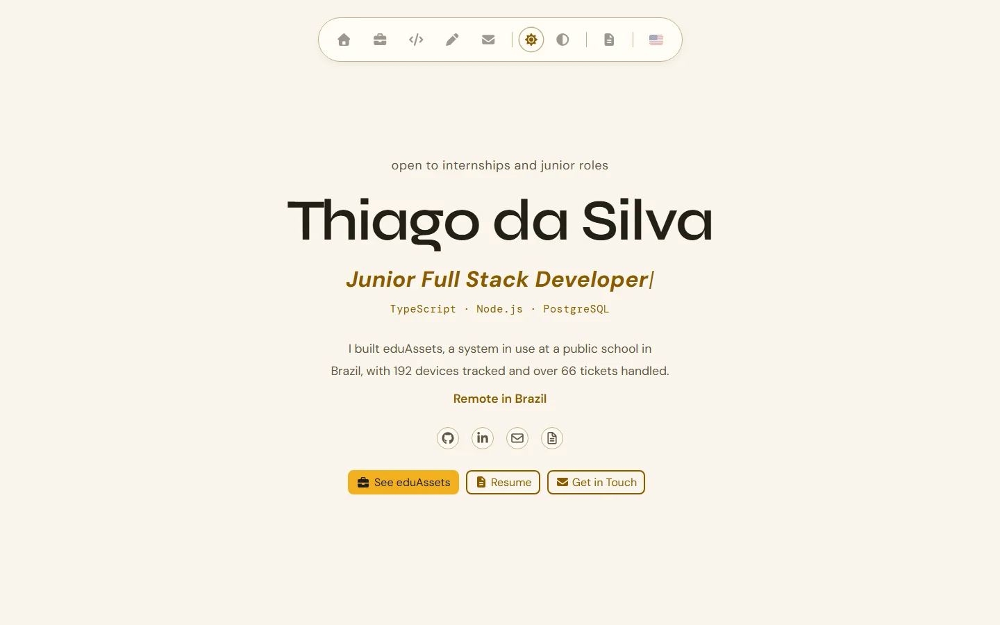
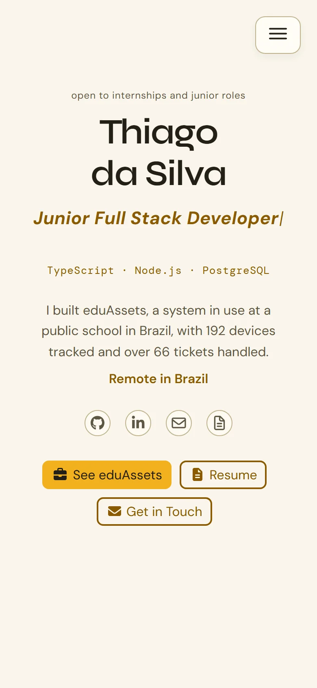
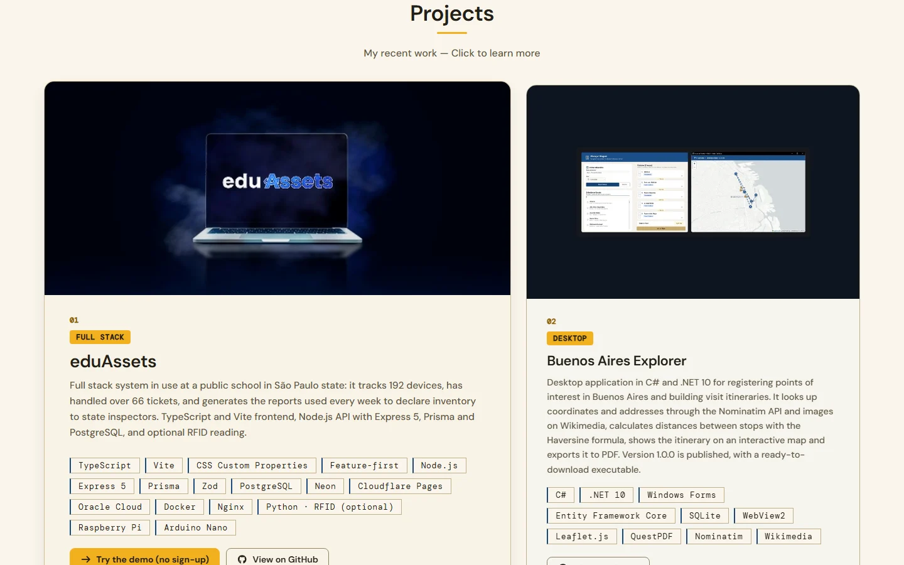
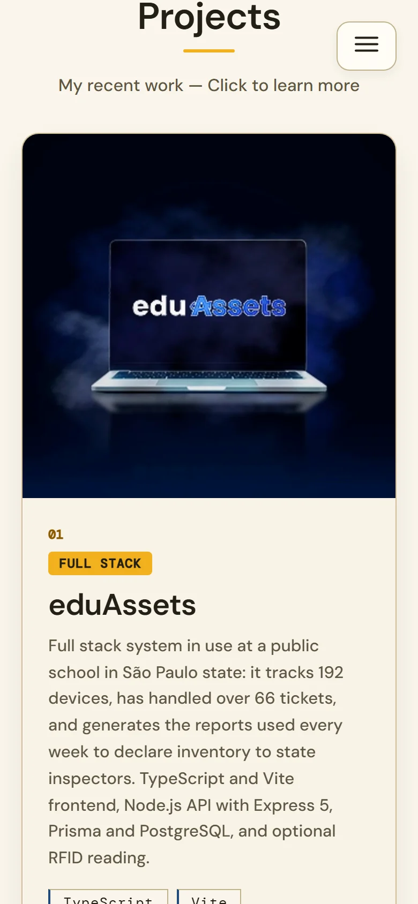
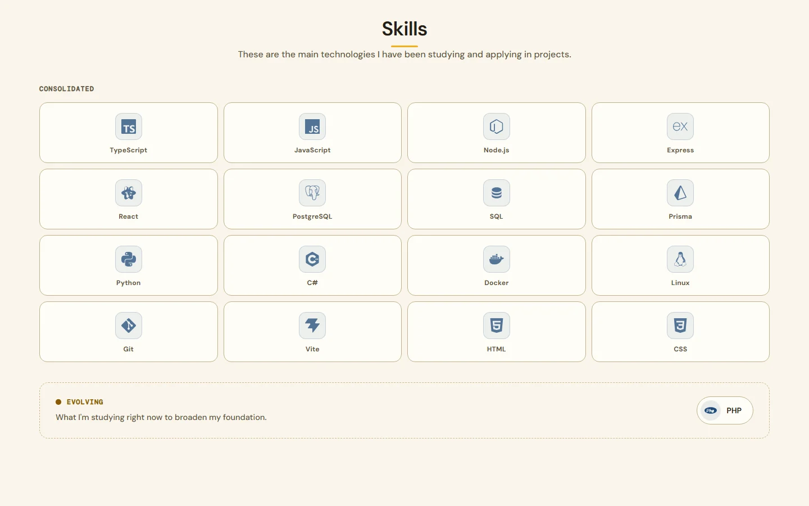
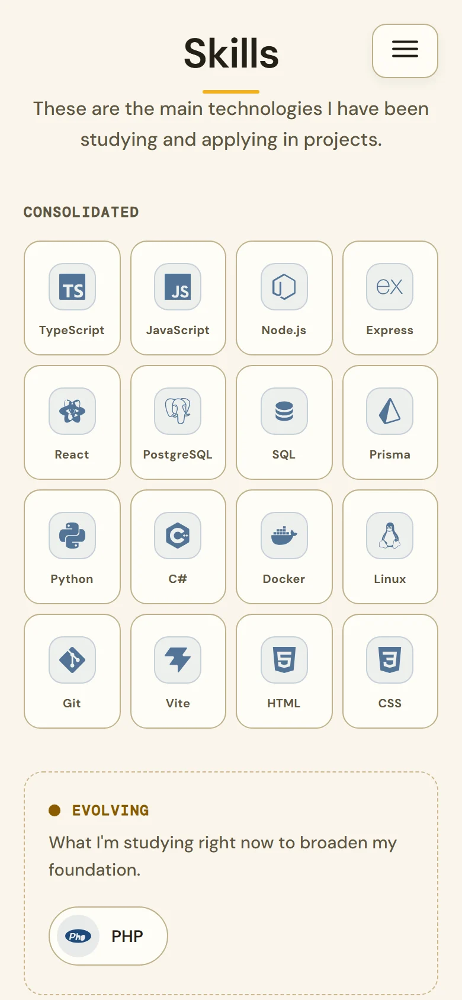
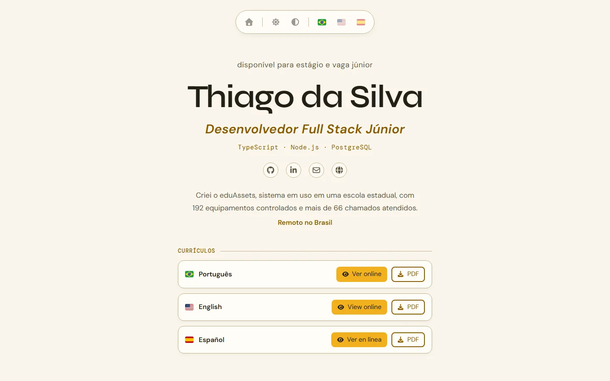
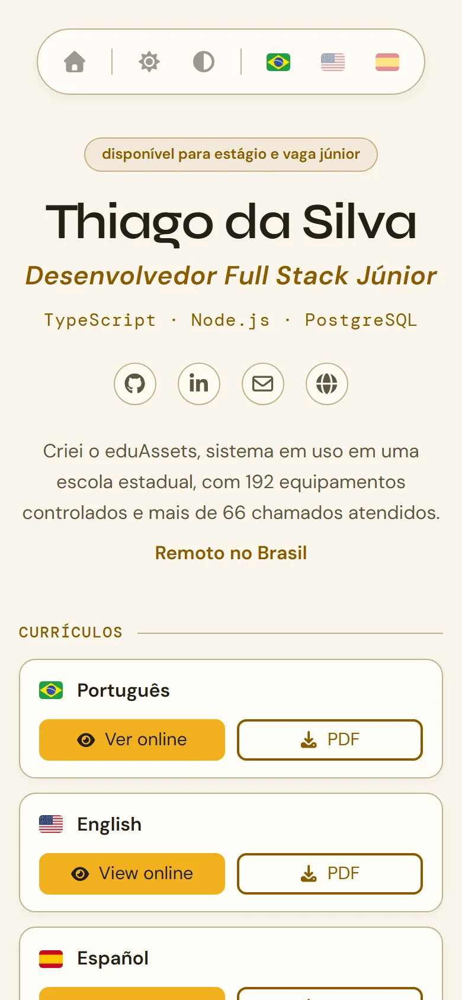
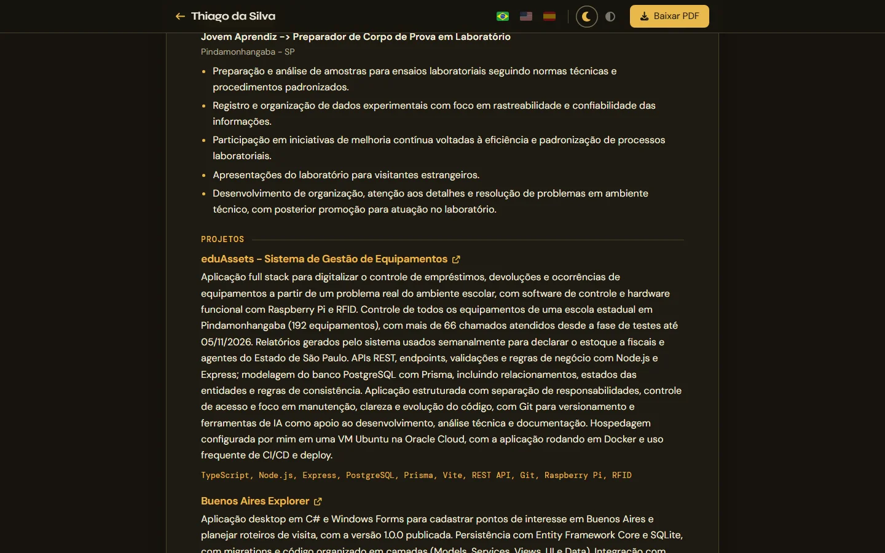
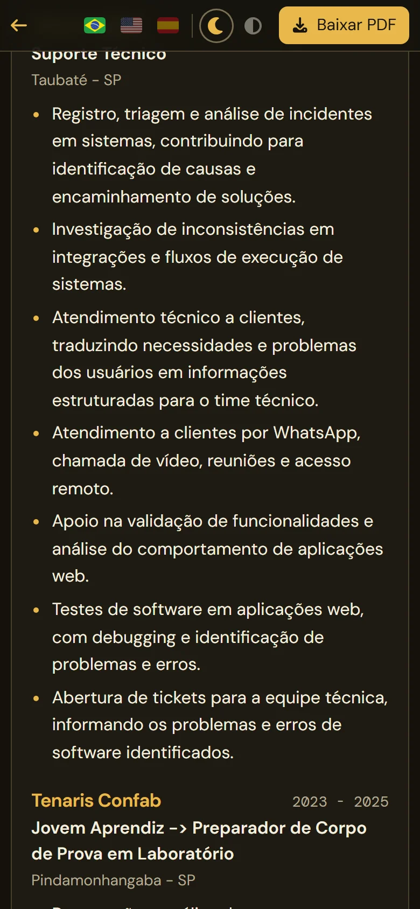

# Thiago da Silva — Developer Portfolio

A multilingual, accessible developer portfolio built with React, TypeScript and Tailwind CSS, pre-rendered to static HTML for every route.

**Live:** [dasilva-thiago.dev](https://www.dasilva-thiago.dev) · **Resumes:** [cv.dasilva-thiago.dev](https://cv.dasilva-thiago.dev)

---

## Screenshots

<table>
  <tr>
    <th>Desktop</th>
    <th>Mobile</th>
  </tr>
  <tr>
    <td></td>
    <td></td>
  </tr>
  <tr>
    <td></td>
    <td></td>
  </tr>
  <tr>
    <td></td>
    <td></td>
  </tr>
</table>

### Resume site (cv.dasilva-thiago.dev)

<table>
  <tr>
    <th>Desktop</th>
    <th>Mobile</th>
  </tr>
  <tr>
    <td></td>
    <td></td>
  </tr>
  <tr>
    <td></td>
    <td></td>
  </tr>
</table>

---

## Highlights

- **Static output, real routes.** Every page is pre-rendered at build time with React Router (`ssr: false` + `prerender`): the home page and the five project pages, each in English, Portuguese and Spanish, plus a real `404.html`. No runtime server, no client-only shell for crawlers.
- **Clean, localized URLs.** `/`, `/pt`, `/es` and `/projects/<slug>` under each locale. Language is part of the URL; switching language is a navigation that keeps the page and the scroll position.
- **Per-page SEO.** Title, description, canonical URL, `hreflang` alternates, Open Graph and Twitter cards, JSON-LD (`ProfilePage` / `Person` / `WebSite` on the home page, `SoftwareSourceCode` / `BreadcrumbList` on project pages), and a `sitemap.xml` generated from the same route data.
- **Strict Content-Security-Policy.** Delivered per page as a `<meta>` tag; every inline script is allow-listed by SHA-256 hash computed at build time. No `'unsafe-inline'` or `'unsafe-eval'` for scripts.
- **No flash of the wrong theme or language.** A tiny synchronous script in `<head>` applies the stored/system theme and sends a first-time visitor at `/` to `/pt` or `/es` before anything paints.
- **Accessibility.** Dark mode and high-contrast mode (independent), native `<dialog>` for the experience details, keyboard-operable navigation, `prefers-reduced-motion` respected by every animation, automated axe checks on every theme and locale.
- **Resumes on their own subdomain.** The resume buttons open [cv.dasilva-thiago.dev](https://cv.dasilva-thiago.dev) in the active language: an HTML resume with the same visual identity and a persistent PDF download, instead of a file on a cloud drive. See [Resume site](#resume-site-cvdasilva-thiagodev-1).
- **Small by design.** About 146 kB of JavaScript (gzip) on first load; animation code is loaded on idle time; icons are tree-shaken data rendered as inline SVG; images are WebP.

---

## What the site shows

The home page follows a recruiter's first read: a hero, then projects, skills, about and contact. The hero combines a typewriter that holds the target role longer and highlights it in the theme color, the main stack, the eduAssets figures and remote availability. Skills are split into consolidated technologies and an "evolving" panel for what is being studied, and the resume buttons open the resume for the active language on `cv.dasilva-thiago.dev`.

| Project | Type | Main stack | Links |
|---|---|---|---|
| eduAssets | Full stack, in real use at a public school | TypeScript, Node.js, Express 5, Prisma, PostgreSQL | [Demo](https://app.eduassets.tech) · [Code](https://github.com/dasilva-thiago/edu-assets) |
| Buenos Aires Explorer | Desktop application | C#, .NET 10, Windows Forms, Entity Framework Core, SQLite | [Code](https://github.com/dasilva-thiago/BuenosAiresExp) |
| Developer Portfolio | Frontend | React, TypeScript, Tailwind CSS, React Router | This repository |
| Aviation Safety Project | Data pipeline | Python, Pandas, Power BI | [Code](https://github.com/dasilva-thiago/aviation_safety_project) |
| Parkschool ALPR | Computer vision microservice, in development | Python, FastAPI, OpenCV, TensorFlow/Keras | [Code](https://github.com/FenixParkSchool/py_vision_park) |

To add or replace a project, update `slugs.ts`, `links.ts` and `projects.ts` in `src/entities/project/model/`, add its copy to the three locale files, register its share image in `scripts/generate-share-images.mjs`, and update the slug lists in `tests/e2e/`.

---

## Resume site (cv.dasilva-thiago.dev)

The three general resumes (Portuguese, English and Spanish) live on a subdomain instead of a shared drive, so a recruiter gets a fast, readable page with a one-click PDF. The site lives in `cv-site/` and is deployed as a **separate Vercel project** from this same repository, so updating a resume never rebuilds the portfolio.

**What it shows**

| URL | Content |
|---|---|
| `/` | Short about for anyone who lands on the subdomain directly: name, target role, stack, GitHub, LinkedIn, email and portfolio links right below the name, a one-line summary, and a card per language with "View online" and "PDF" |
| `/pt`, `/en`, `/es` | The full resume as HTML: summary, experience, projects, education, courses and skills |
| `/thiago-da-silva-cv-{pt,en,es}.pdf` | The PDF of each resume |

**How it works**

- **Same visual identity as the portfolio.** It reuses the portfolio's color tokens (light, dark and high contrast), fonts (DM Sans, Syne, DM Mono, self-hosted), Font Awesome icons, flags and the pill navbar style.
- **Language flags.** On the landing page they switch the text in place; the language follows the stored choice, then the browser language. On resume pages they link between the three resumes.
- **Light/dark and high-contrast toggles**, applied by a tiny script in `<head>` before the first paint, as on the portfolio. The choice is stored per site; on a first visit both sites follow the system theme.
- **Persistent PDF download.** On resume pages a sticky bar keeps the language flags, the theme toggles and the "Download PDF" button visible while scrolling. Printing the page hides the bar and prints a clean resume.
- **Generated, not hand-written.** `cv-site/tools/build.mjs` renders `public/index.html` and `public/{pt,en,es}.html` from the resume data in `cv-site/src/data/cv-{lang}.json`. Vercel serves `cv-site/public/` as-is, with no build step on deploy.
- **Private by default.** No phone number in the public versions, and every response carries `X-Robots-Tag: noindex`. `cv-site/vercel.json` sets a strict Content-Security-Policy (`default-src 'none'`; scripts, styles, fonts and images from the site itself only) plus the same security headers as the portfolio.

**Updating a resume:** copy the new data to `cv-site/src/data/cv-{lang}.json` and the PDF to `cv-site/public/`, run `node cv-site/tools/build.mjs` and commit. Details in [`cv-site/README.md`](cv-site/README.md).

---

## Tech stack

| Technology | Purpose |
|---|---|
| React 19 + TypeScript (strict) | UI and types |
| React Router (Framework Mode, `ssr: false`) | Routing and build-time pre-rendering |
| Vite | Build tool and dev server |
| Tailwind CSS v4 | Styling, mapped to the design tokens in `src/shared/styles/tokens.css` |
| GSAP + ScrollTrigger | Scroll reveals (lazy-loaded, reduced-motion aware) |
| Font Awesome (icon data only) | Icons rendered as inline SVG |
| Fontsource (DM Sans, DM Mono, Syne) | Self-hosted fonts |
| Web3Forms | Contact form delivery (client-side, public access key) |
| Vitest + Testing Library | Unit and component tests |
| Playwright + axe-core | End-to-end, SEO, security and accessibility tests |

---

## Project structure

A lightweight, feature-oriented layout inspired by Feature-Sliced Design. Higher layers may import lower ones, never the reverse, and slices on the same layer do not import each other. `src/architecture.test.ts` enforces this.

```
src/
├── app/         root document, routes, SEO metadata, analytics, pre-paint script
├── pages/       route-level compositions (home, project, not-found)
├── widgets/     page sections: site-nav, hero, about, skills, projects, contact, footer
├── features/    user capabilities: switch-language, toggle-appearance, contact-form,
│                experience-details (dialog), open-cv, locale-entry (first-visit redirect)
├── entities/    domain data and UI: project, experience, skill
└── shared/      i18n, config, UI primitives, helpers, styles, assets
scripts/         build post-processing (CSP hashes, 404 page, sitemap) and its tests
static/          files copied as-is: robots.txt and the stable share images (og/, images/)
tests/           Playwright specs (e2e/), static host used by the tests, visual baseline tools
docs/            architecture notes and the README screenshots
cv-site/         resume subdomain (cv.dasilva-thiago.dev): data, page generator and static output
server/          legacy email API kept in the repository; not part of the static deployment
```

---

## Internationalization

- Supported locales: English (default), Portuguese, Spanish.
- Copy lives in `src/shared/i18n/resources/{en,pt,es}.json` with identical key shapes, keyed by project slug or experience id. Tests enforce key parity, equal array lengths, no empty strings and balanced inline markers.
- Keys are typed from `en.json`, so a misspelled key fails `tsc`.
- Each route loads only its own locale's JSON. Rich text (the highlighted phrase in the About quote) is rendered from `<em>` markers as elements, never as HTML.
- **First visit to `/`:** stored preference, then browser language, then English. Prefixed URLs and project URLs are never redirected. The preference is stored only when the user switches language explicitly.
- **Legacy links:** `/#projects/<slug>` redirects to the real project route.

---

## SEO, security and analytics

- Per-route `meta` exports build title, description, canonical, alternates, social tags and JSON-LD from the locale resources and typed project data (`src/app/seo/`).
- After the build, `scripts/postbuild.ts` writes `sitemap.xml` (18 URLs with reciprocal `hreflang` alternates), turns the prerendered 404 route into `404.html`, removes the SPA fallback, and injects the Content-Security-Policy meta tag into every HTML file.
- `vercel.json` adds security headers (`X-Content-Type-Options`, `Referrer-Policy`, `X-Frame-Options`, `Permissions-Policy`), long-lived caching for hashed assets, and `trailingSlash: false`.
- Google Analytics only activates on the production hostname (so previews and local runs send nothing) and sends one `page_view` per route change.

---

## Contact form

Powered by [Web3Forms](https://web3forms.com) directly from the browser, with a public access key (not a secret). The client validates empty fields and email format, uses a honeypot field, shows a live character counter, and reports success, provider failure and network error in the active language. Client-side validation is a UX aid; spam control relies on the honeypot and the provider.

---

## Scripts

```bash
npm install
npm run dev          # React Router dev server
npm run build        # pre-render all routes + post-process (CSP, sitemap, 404)
npm run preview      # static host that mirrors the production routing, on :4173
npm run typecheck    # react-router typegen && tsc (strict)
npm test             # Vitest unit and component tests
npm run test:e2e     # Playwright (builds are served from build/client; run `npm run build` first)
npm run og:images    # regenerate the 1200x630 share images in static/og (needs `npm run preview` running)
```

Node 20.19+ is required (see `engines`).

---

## Deployment (Vercel)

Static deployment of `build/client`, configured in `vercel.json` (`framework: null`, `buildCommand`, `outputDirectory`, headers, `trailingSlash: false`). No environment variables are needed. Unknown URLs return the real `404.html` with a 404 status; under `/pt` and `/es` the page switches to that language in the browser. Node.js 20.19+ must be selected in the Vercel project settings.

The resume subdomain is a second Vercel project on the same repository, with **Root Directory** `cv-site` and framework "Other". Its `cv-site/vercel.json` serves `public/` with no build command, clean URLs (`/pt` instead of `/pt.html`) and its own headers. The `cv.dasilva-thiago.dev` domain is attached to that project only.

---

## Testing

- **Unit/component:** locale parity, typed keys, project data, layer boundaries, contact validation and submission, pre-paint script, CSP builder, sitemap and metadata.
- **End-to-end:** every route, language switching and redirects, legacy links, theme and contrast, navigation and the mobile drawer, the hero typewriter, the experience dialog, the contact form with a mocked provider, CV links (each locale opens its resume on `cv.dasilva-thiago.dev`), reduced motion, hydration without console warnings, per-page head contents, CSP hashes and zero violations, analytics, 404 behavior, and axe (WCAG 2.0/2.1 A and AA) on home and project pages in light, dark and high-contrast themes for three locales. The same checks run in GitHub Actions on every push and pull request (`.github/workflows/ci.yml`).
- **Visual and layout tools:** `tests/visual-baseline/` can capture screenshots, compare them against a reference, and measure element geometry.

---

## Contact

- **Website:** [dasilva-thiago.dev](https://www.dasilva-thiago.dev)
- **LinkedIn:** [linkedin.com/in/dasilva-thiago](https://www.linkedin.com/in/dasilva-thiago/)
- **GitHub:** [github.com/dasilva-thiago](https://github.com/dasilva-thiago)
- **Email:** thiagosilva785@gmail.com

---

<p align="center">Made by Thiago da Silva • Pindamonhangaba, SP, Brazil</p>
